# Code Classic — Phase 1 Session Visual Report

> **Report type:** Planned session roadmap and acceptance gates  
> **Baseline source of truth:** [`brd-docs.md`](../initial-project-docs/brd-docs.md), [`tdd-docs.md`](../initial-project-docs/tdd-docs.md), and [`front-end-UI-design-doc.md`](../initial-project-docs/front-end-UI-design-doc.md). The [master execution plan](../initial-project-docs/master-execution-plan.md) sequences BRD Phase 1 into ten sessions.  
> **Current implementation status:** Session 1 is **Accepted** based on the project owner's completion confirmation, supplied terminal output and GitHub screenshot, and the matching local branch/tracking refs recorded at that time. Session 2 shared layout and placeholder routing are **Accepted per owner direction**: parent-verified checks and the local Git checkpoint are recorded below. Actual social account URLs are an owner-approved optional follow-up, not a blocking acceptance requirement; they are not configured, and no remote push is claimed. Sessions 3–10 remain **Not Started**.
> **Last reviewed:** 2026-11-15  
>
> This report visualizes the planned Phase 1 work. It is not evidence that a session, feature, test, or deployment is complete. Update status only when repository evidence and the session's acceptance criteria support it.

## Phase 1 at a glance

Code Classic Phase 1 is planned as a public technical blog and administrator-managed publishing platform, with verified user authentication, password reset, and deployment. The baseline stack is React, JavaScript, Vite, Bootstrap 5, React Router, Firebase Authentication, Cloud Firestore and Security Rules, Git/GitHub, Cloudflare Pages, and YouTube embeds. It does not include a custom backend, Spring Boot, microservices, or functional Q&A.

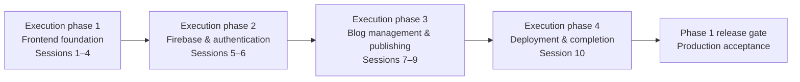

The four phases above are the **development-series groupings** from the master execution plan. The BRD separately describes three broader product-release phases; those two uses of “phase” should not be conflated.

**Planning note:** The master plan targets 20–25 minutes for each of ten recordings, which totals 200–250 minutes (3 hours 20 minutes–4 hours 10 minutes). Its stated overall estimate is approximately 4–4.2 hours. Keep the per-session target as the actionable estimate; reconcile the overall estimate when recording durations are known.

## Roadmap and milestone tracker

| Session | Execution phase | Planned milestone | Depends on | Status |
|---|---|---|---|---|
| 1 | Frontend foundation | Vite React application runs locally and is connected to GitHub | None | Accepted |
| 2 | Frontend foundation | Responsive shared layout, working routes, and Q&A Coming Soon placeholder | Session 1 | Accepted |
| 3 | Frontend foundation | Responsive Code Classic homepage matches the approved visual baseline | Session 2 and UI specification | Not Started |
| 4 | Frontend foundation | Visitors can browse blog listings and detail pages | Sessions 2–3 | Not Started |
| 5 | Firebase & authentication | Verified email/password and Google sign-in, password reset, and session handling work | Session 1; frontend routes from Session 2 | Not Started |
| 6 | Firebase & authentication | Profiles, trusted admin authorization, and Firestore rules are tested | Session 5 | Not Started |
| 7 | Blog management & publishing | Authorized admin can access dashboard/blog list and delete posts with confirmation | Session 6 | Not Started |
| 8 | Blog management & publishing | Admin can create, save, reopen, and edit drafts/posts | Session 7 | Not Started |
| 9 | Blog management & publishing | Admin publishing is integrated with public blog views | Sessions 4, 6, and 8 | Not Started |
| 10 | Deployment & completion | Application is deployed on Cloudflare Pages and passes production checks | Sessions 1–9 | Not Started |

**Session 2 status note:** Accepted per the owner's explicit direction. The owner has designated actual social account URLs as an optional deferred follow-up; the existing inert social labels are documented below and do not block this session's acceptance. The verified Git checkpoint is local only; remote push status is unverified.

**Status vocabulary**

- **Not Started:** No evidence that work on the milestone has begun.
- **In Progress:** Work has begun, but the acceptance gate has not passed.
- **Blocked:** A requirement, dependency, security, or data-integrity issue prevents safe completion.
- **Conditionally Accepted:** Critical checks pass; only documented non-critical follow-up remains.
- **Accepted:** All required acceptance criteria and evidence pass, the application is stable, and the Git checkpoint is complete.

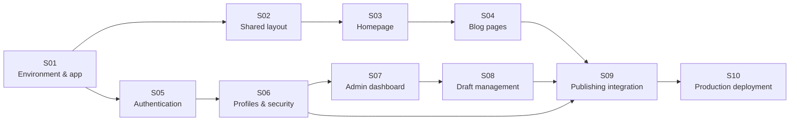

The dependency arrows show the planned handoffs, not completed work. Sessions should only be marked accepted after their own gates pass.

## Session-by-session visual report

### Session 1 — Development Environment and React Application

**Execution phase:** Frontend foundation · **Target recording:** 20–25 minutes  
**Status:** Accepted · **Depends on:** None

**Goal:** Verify the development tools, create the Vite React JavaScript application, understand its generated structure, run it locally, and establish the first GitHub checkpoint.

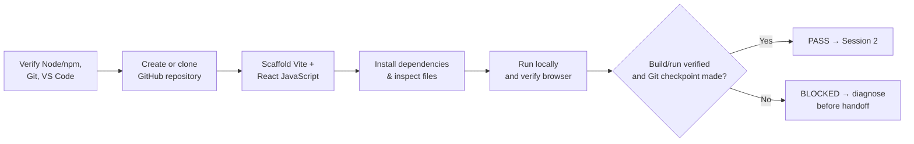

**Expected handoff:** A locally running Vite/React application, a verified repository connection, and a first commit.  
**Acceptance focus:** Tool versions/configuration are verified; the starter app runs locally and builds; the generated project is scaffolded; the GitHub checkpoint succeeds without committing generated dependencies, build output, or secrets. Browser interaction and hot-reload are part of the owner's completed session; hot-reload recording is optional.

**Completion evidence — owner-confirmed and supplied by the user (2026-11-15):**

- User terminal output records Node.js `v22.21.0`, npm `11.6.2`, Git identity configuration, the React + JavaScript + ESLint Vite scaffold in the non-empty project directory (choosing **Ignore files and continue**), and successful dependency installation.
- The scaffold and a separate `npm run dev` invocation both reported Vite ready at `http://localhost:5173`. The owner confirms Session 1 is complete; the assistant did not independently repeat the browser interaction.
- User terminal output records `npm run build` succeeding with Vite `v8.3.8` and 20 modules transformed.
- At the time of the Session 1 inspection, the repository source was consistent with a Vite/React starter scaffold. Session 2 has since replaced the active rendered starter view with shared layout and placeholder routes; those later changes do not imply completion of product features beyond their stated placeholder behavior.
- The supplied GitHub screenshot shows `jaydeeprajputprojects-wq/codeclassic`, branch `feature/project-setup`, a recent push, and latest visible commit `ad4a201` (`feat: initialize React app with Vite, add main components and st...`) with the project tree.
- **Local Git verification at the Session 1 checkpoint:** the checked-out branch and `origin/feature/project-setup` tracking ref both pointed to `ad4a20173e96828013826fd94c4d566f848f98ec`. `git ls-files` confirmed `node_modules/`, `dist/`, and `.env*` paths were not tracked. The worktree observation from that checkpoint is historical, not a statement of current Git status. A fresh request to GitHub's live remote and browser rendering were not performed by the assistant.

**Acceptance outcome:** The project owner confirms Session 1 is complete. Supplied terminal output covers setup, dependency installation, local server startup, and production build; the GitHub screenshot and matching local refs cover the pushed checkpoint. The assistant did not independently replay browser/HMR checks or query GitHub live. This session establishes only the starter-project foundation; it does not mark any Code Classic product feature or later session complete.

### Session 2 — Frontend Configuration and Common Layout

**Execution phase:** Frontend foundation · **Target recording:** 20–25 minutes  
**Status:** Accepted per owner direction · **Depends on:** Session 1

**Goal:** Follow the owner-supplied Session 2 slide order to configure dependencies and imports, establish the frontend folders and clean starter state, add placeholder pages and routes, implement the responsive shared header/navigation/layout/footer, and verify the build and checkpoint.

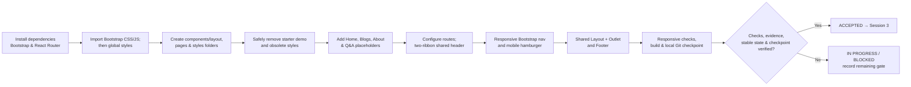

**Expected handoff:** A responsive shared shell and routes for Home, Blogs (including category path), Q&A Coming Soon, About, and Login. Homepage and blog functionality remain placeholders for later sessions.
**Acceptance focus:** The required dependency/import/folder/page/route/layout sequence is implemented; Bootstrap styles precede global styles; the two-ribbon header and mobile navigation behave responsively; `<Outlet />` renders child routes and a shared footer; Q&A remains non-functional Coming Soon only; mandatory responsive/build checks and the local Git checkpoint are evidenced. Per the owner's explicit direction, actual social account URLs are optional follow-up rather than a blocking acceptance requirement; the current labels remain inert.

**Required implementation order — owner-supplied slide screenshots:** The sequence below records the requested Session 2 teaching/implementation order. It is not proof of the order in which the current source edits were made.

- **1 — Dependencies:** install Bootstrap and React Router.
- **2 — Imports:** load Bootstrap CSS and JavaScript, then the global stylesheet after Bootstrap CSS.
- **3 — Folders and cleanup:** use `src/components/layout/`, `src/pages/`, and `src/styles/`; safely remove the Vite demo and obsolete starter styles.
- **4 — Placeholder pages:** create distinct Home, Blogs, About, and Q&A Coming Soon pages. Login remains available; category placeholders use the URL category.
- **5 — Routes and shared header:** configure the pages' routes and two-ribbon header.
- **6 — Responsive navigation:** use Bootstrap navigation with a mobile hamburger at the top-right.
- **7 — Shared shell:** place the header and footer around nested route content via `<Outlet />`.
- **8 — Responsive verification/checkpoint:** perform responsive checks, run the build/checks, and create the Git checkpoint before acceptance.

**Current source evidence — inspected 2026-11-15:**

- `package.json` declares Bootstrap `^5.3.9` and `react-router-dom` `^7.18.5`.
- `src/main.jsx` imports Bootstrap CSS, Bootstrap's bundle JavaScript, then `src/styles/global.css`; it wraps `App` in `BrowserRouter`.
- Current source has `src/components/layout/Header.jsx`, `Footer.jsx`, and `Layout.jsx`. `Layout` renders the shared header, `<Outlet />`, and footer.
- `src/App.jsx` nests routes under `Layout`: `/`, `/blog`, `/blog/:category`, `/qa`, `/about`, `/login`, and a not-found route. The category page reads the URL category. Login remains present.
- Distinct pages are present at `src/pages/Home.jsx`, `Blogs.jsx`, `About.jsx`, `Login.jsx`, and `QAComingSoon.jsx`. The Q&A page shows a Coming Soon message only.
- `src/styles/global.css` contains the shared shell and responsive styling. The current `src` listing does not contain the old Vite `App.css`/`index.css` or the previously used generic `PlaceholderPage.jsx`/`SiteLayout.jsx`; safe removal history cannot be independently established without the Git diff.
- The header implements two ribbons, the mobile hamburger at the top-right, Bootstrap collapse/dropdown behavior, and a Login route. Its YouTube, LinkedIn, and Instagram entries are inert text placeholders with “not configured” titles, not working links. Per the owner, the account URLs are not configured. The UI specification calls for configured social links; the owner explicitly directed that actual URLs be treated as optional deferred follow-up and not as an acceptance blocker. Do not represent the placeholders as functional social links.
- This is placeholder routing/layout work only, not the Session 3 homepage, Session 4 blog functionality, or later product features.

**Validation and Git evidence — source inspection and parent-reported checks:**

- **Parent-reported automated checks on the latest reorganized source:** `npm run lint` passed and `npm run build` passed. The report updater did not independently run these commands or inspect their terminal output.
- **Parent-reported direct-route fallback:** requests for `/`, `/blog`, `/blog/java`, `/qa`, `/about`, `/login`, and `/missing-route` returned the app's SPA entry/fallback.
- **Parent-reported browser checks:** on mobile, the hamburger at the upper-right opens the navigation and the menu closes after selecting Home once the Bootstrap transition completes. At 1280px, the desktop navbar is visible and the mobile toggle is hidden. The Blog dropdown opens, and `/blog/java` displays “Java Blogs”. `/qa` displays the Coming Soon state with zero buttons, inputs, or textareas.
- **User-supplied Git inspection:** branch `feature/session-2` is at `310d7d1` (`feat: integrate Bootstrap for styling and layout, add routing with React Router`), and the worktree was clean when checked. This local commit is the Git checkpoint for Session 2. The branch has no upstream and is not confirmed pushed; this report makes no remote-push claim.
- No feature-level automated tests were reported. The checks above cover Session 2 lint/build, route fallback, and specified navigation behavior only; they do not prove later Phase 1 functionality or a production/security gate.

**Acceptance outcome — Accepted per owner direction:** The parent-verified lint/build, route fallback, and specified browser behavior checks, together with the inspected shared layout/routes and the user-supplied clean-worktree Git inspection at local commit `310d7d1`, support acceptance of this Session 2 milestone. This acceptance covers the shared shell, placeholder pages/routes, responsive navigation and Q&A Coming Soon placeholder only; it does not mark the Session 3 homepage, Session 4 blog functionality, or later Phase 1 features complete. Actual social account URLs remain an explicitly owner-approved optional follow-up, not a blocker. The commit is local; no upstream or remote push is confirmed. The updater did not independently rerun the reported commands or browser checks. Session 1 remains **Accepted** and Sessions 3–10 remain **Not Started**.

### Session 3 — Code Classic Homepage

**Execution phase:** Frontend foundation · **Target recording:** 20–25 minutes  
**Status:** Not Started · **Depends on:** Session 2 and the approved UI specification

**Goal:** Build the homepage against the design document and reference image, including a three-column desktop composition, banner carousel, exactly five latest-blog previews, sidebars, and responsive rearrangement.

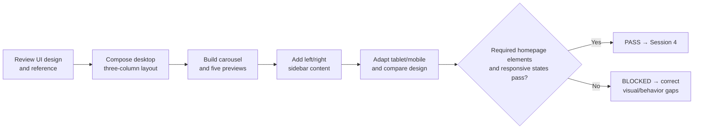

**Expected handoff:** A responsive homepage using temporary content where the backend is not yet available.  
**Acceptance focus:** Required homepage regions and exactly five previews are present; tablet/mobile layouts remain usable; visual comparison is recorded.

### Session 4 — Blog Listing and Detail Pages

**Execution phase:** Frontend foundation · **Target recording:** 20–25 minutes  
**Status:** Not Started · **Depends on:** Sessions 2–3

**Goal:** Add the blog listing and individual blog detail experience, including categories, ten previews per listing page, pagination, safe Markdown rendering, and YouTube embedding.

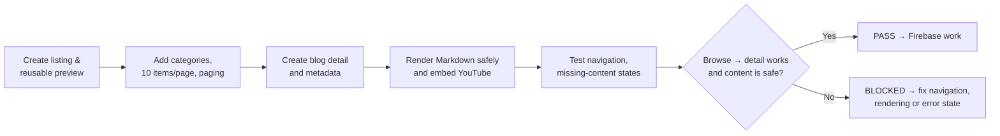

**Expected handoff:** Public-facing blog pages can use temporary content until Firebase integration.  
**Acceptance focus:** Listing/detail navigation works, pagination preserves category, invalid content is handled, and Markdown does not execute unsafe raw HTML.

### Session 5 — Firebase and Authentication

**Execution phase:** Firebase & authentication · **Target recording:** 20–25 minutes  
**Status:** Not Started · **Depends on:** Session 1; frontend routes from Session 2

**Goal:** Configure the Firebase web application and environment configuration; implement email/password and Google registration/sign-in, required email verification, password reset, logout, error handling, and auth-state persistence.

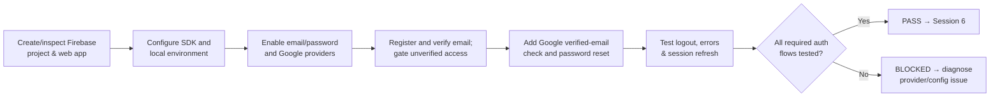

**Expected handoff:** Users can register, verify email, sign in/out, and reset passwords; configuration secrets are not committed.  
**Acceptance focus:** Verification email/pending and verified access behavior pass; unverified email/password users are gated; Google access requires a verified provider email; password-reset link works; auth state refreshes after verification.

### Session 6 — User Profiles, Admin Authorization and Firestore Security

**Execution phase:** Firebase & authentication · **Target recording:** 20–25 minutes  
**Status:** Not Started · **Depends on:** Session 5

**Goal:** Define profile/blog data shapes, configure Firestore, provision admin privilege through a trusted process, guard admin routes, and enforce verified-user and data permissions with Firestore Security Rules.

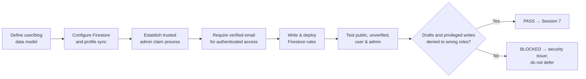

**Expected handoff:** Profile and post models, a trusted admin assignment process, and tested database authorization.  
**Acceptance focus:** Public users can read published posts only; unverified users cannot use authenticated features; drafts and admin writes/deletes are denied to public/ordinary users; users cannot self-assign admin. A UI route guard is not a substitute for database rules.

### Session 7 — Admin Dashboard and Blog Management Interface

**Execution phase:** Blog management & publishing · **Target recording:** 20–25 minutes  
**Status:** Not Started · **Depends on:** Session 6

**Goal:** Build a guarded admin dashboard and blog list with status/timestamp information, create/edit/view/delete actions, explicit delete confirmation, and loading, empty, and error states.

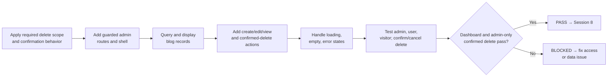

**Expected handoff:** Admin can see the management interface and perform confirmed post deletion; create/edit routes may still be placeholders.  
**Acceptance focus:** Admin-only access, accurate blog rows, visible UI states, no public draft access; confirm deletion removes the post, cancellation preserves it, and unauthorized deletion is denied.

### Session 8 — Blog Creation, Editing and Draft Management

**Execution phase:** Blog management & publishing · **Target recording:** 20–25 minutes  
**Status:** Not Started · **Depends on:** Session 7

**Goal:** Implement a validated admin form for title, description, Markdown content, category, tags, YouTube video ID, and optional thumbnail; save drafts and edit existing posts with correct timestamps.

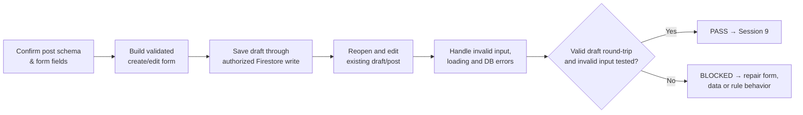

**Expected handoff:** An administrator can create, save, reopen, and edit drafts and existing posts.  
**Acceptance focus:** Required fields are validated; timestamps and status are correct; failures are visible; unauthorized writes remain denied.

### Session 9 — Blog Publishing and Public Content Integration

**Execution phase:** Blog management & publishing · **Target recording:** 20–25 minutes  
**Status:** Not Started · **Depends on:** Sessions 4, 6, and 8

**Goal:** Implement publish/unpublish operations and connect homepage, listing, and detail pages to Firestore while preserving published-only public access.

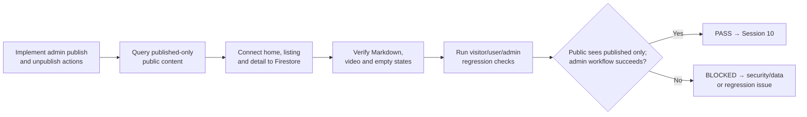

**Expected handoff:** Admin publication changes are reflected in public pages, and unpublishing removes public access.  
**Acceptance focus:** Public queries request published content; security rules independently prevent draft reads; admin publish/unpublish and all three role perspectives are verified.

### Session 10 — Cloudflare Deployment and Production Testing

**Execution phase:** Deployment & completion · **Target recording:** 20–25 minutes  
**Status:** Not Started · **Depends on:** Sessions 1–9

**Goal:** Build and deploy the application to Cloudflare Pages, configure production environment values and SPA routing as needed, and run production smoke, authentication, content, and security checks.

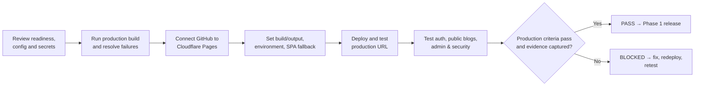

**Expected handoff:** A live Cloudflare Pages deployment with documented URL, production test evidence, and known limitations.  
**Acceptance focus:** Production build and deployment succeed; public pages/auth/admin flows are checked; Firestore rules are independently tested; no privileged credentials are exposed; browser/network failures are investigated.

## Cross-session acceptance and reporting rules

Each session requires an observable acceptance check, mandatory evidence, a stable state, and a Git checkpoint before it can be marked **Accepted**. A completed coding task alone is not a passing milestone.

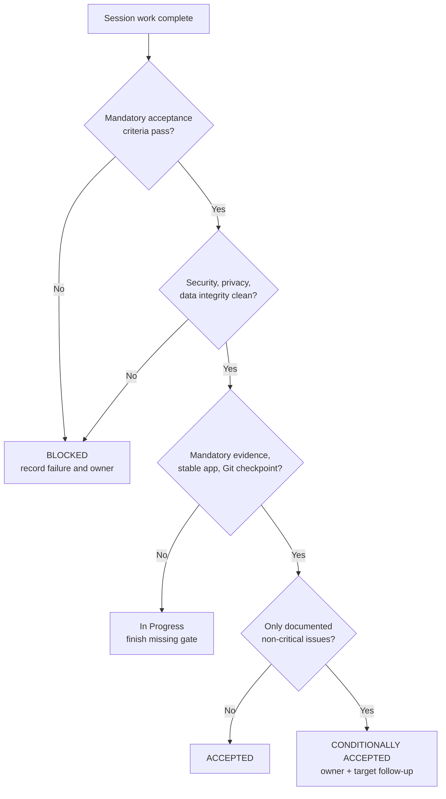

Never defer a security, privacy, or data-integrity issue as a conditional acceptance. Do not mark a check as passing without performing and recording it.

## Phase 1 scope guardrails

- **In scope:** public published blogs, email/password verification, Google sign-in for verified provider emails, password reset, profiles, trusted administrator blog management including confirmed deletion, drafts/publishing, responsive UI, YouTube embeds, Firestore access control, and Cloudflare Pages deployment.
- **Not functional Phase 1 features:** user-generated blogs, comments/replies, likes, functional Q&A, courses, documents, jobs, notifications, and advanced analytics.
- **Q&A placeholder:** show only “Coming Soon”; no sample/live-looking questions, question detail, answers, comments, search, or submission flows.
- **Architecture constraints:** no Spring Boot, microservices, API Gateway, unnecessary custom backend, or unapproved services.
- **Security constraints:** Firestore rules enforce data access; frontend route guards are supplemental; admin claims must come from a trusted process; never expose service-account credentials in client code.
- **Resolved baseline decisions:** delete is required for administrators with explicit confirmation; email verification and password reset are required authentication flows; Q&A is placeholder-only.

## Update log

| Date | Update |
|---|---|
| 2026-11-14 | Created the initial visual roadmap from the 10-session master execution plan. All sessions are recorded as Not Started because no application implementation was verified. |
| 2026-11-14 | Recorded the difference between the summed per-session duration and the master plan's approximate overall recording estimate. |
| 2026-11-14 | Aligned Phase 1 report with the baseline BRD/TDD/UI decisions: verified-email access, password reset, confirmed admin deletion, Q&A Coming Soon only, and the master plan's Phase 1-only execution scope. |
| 2026-11-15 | Updated Session 1 to In Progress based on user-provided terminal output for local tools, create-vite scaffolding in a non-empty directory (Ignore files and continue), dependency installation, Vite dev-server output at `http://localhost:5173`, and a successful production build. Distinguished those claims from inspected starter source and recorded the unverified browser, GitHub/checkpoint, and remaining acceptance evidence. No product-feature status or other session status was advanced. |
| 2026-11-15 | Recorded the user's report and screenshot description of a push to `feature/project-setup` at `ad4a201`, plus matching local branch and `origin` tracking refs/reflog. Clarified that the screenshot was not directly accessible and GitHub's live remote, working-tree cleanliness, and browser rendering were not independently verified. Session 1 remains In Progress because required acceptance evidence is incomplete; no other session status changed. |
| 2026-11-15 | Marked Session 1 Accepted at the owner's request after their completion confirmation. Recorded the supplied terminal output and GitHub screenshot, matching local branch/tracking refs at `ad4a201`, and verified that build output, dependencies, and environment files are not tracked. Noted that the assistant did not independently repeat browser/HMR checks or query GitHub live. Sessions 2–10 remain Not Started. |
| 2026-11-15 | Recorded Session 2 as In Progress after implementing the shared responsive layout and placeholder routes. The project owner reported passing lint/build, direct SPA route responses, mobile collapse/dropdown navigation, desktop navigation visibility, and Q&A placeholder-only behavior. The Session 2 Git checkpoint and UI-specified social links remain outstanding; Sessions 3–10 remain Not Started. |
| 2026-11-15 | Updated Session 2 evidence after inspecting the current router, layout, placeholder, styles, and dependencies. Distinguished inspected source from owner-reported browser, direct-request, lint/build, and diff-check results; recorded that the work remains local and uncommitted/unpushed per the owner, while current Git status was not independently queried. Confirmed the required social icons/links are absent and URLs were not provided. Kept Session 1 Accepted, Sessions 3–10 Not Started, and the ten-session scope and diagrams unchanged. |
| 2026-11-15 | Refreshed Session 2 against the latest reorganized source and the owner-supplied slide sequence: dependencies/import order, folders and starter cleanup, distinct placeholder pages/routes, two-ribbon responsive header/navigation, shared `<Outlet />` layout/footer, and responsive validation/checkpoint. Inspected current entry point, routes, layout components, pages, stylesheet, and dependencies. The manual-change notes file was present but empty; the supplied slide sequence was recorded as owner-provided direction, not inferred from code history. Replaced stale SiteLayout/PlaceholderPage/index.css evidence with current Header/Footer/Layout and `global.css` paths. Recorded inert social-name placeholders (not functional links) because URLs are not configured. Earlier lint/build passes predate this reorganization; no rerun, final browser evidence, fresh Git diff/status, or checkpoint was available. Session 2 remains In Progress; all other statuses and the ten-session scope remain unchanged. |
| 2026-11-15 | Follow-up: recorded parent-reported passing `npm run lint` and `npm run build` on the latest reorganized source; direct-route fallback for `/`, `/blog`, `/blog/java`, `/qa`, `/about`, `/login`, and `/missing-route`; and browser checks for mobile hamburger open/close, desktop navbar/mobile-toggle visibility at 1280px, Blog dropdown/category heading, and Q&A Coming Soon with no buttons or form controls. Recorded parent-reported `git status -sb`: `feature/session-2` at `ad4a201`, no upstream marker, modified/untracked local files, no commit/push. Removed trailing whitespace from the Expected handoff line reported by `git diff --check`; parent will rerun the diff check after this edit. Session 2 remains In Progress because the checkpoint and configured social URLs/links remain outstanding. |
| 2026-11-15 | Marked Session 2 Accepted per the owner's explicit direction. Recorded the parent-verified lint/build, route fallback, and responsive/browser checks, plus the user-supplied Git inspection showing clean worktree on `feature/session-2` at local commit `310d7d1`. The local commit is the checkpoint; the branch has no upstream and is not confirmed pushed. Recorded actual social account URLs as an owner-approved optional deferred follow-up, not a blocking acceptance requirement, while retaining the transparent note that current social labels are inert and the UI baseline calls for configured links. Session 2 scope remains layout, placeholder routes, responsive navigation, and Q&A Coming Soon only; Sessions 3–10 remain Not Started. No commands or browser checks were rerun by the report updater. |
