# Code Classic — Phase 1 Session Visual Report

> **Report type:** Planned session roadmap and acceptance gates  
> **Baseline source of truth:** [`brd-docs.md`](../initial-project-docs/brd-docs.md), [`tdd-docs.md`](../initial-project-docs/tdd-docs.md), and [`front-end-UI-design-doc.md`](../initial-project-docs/front-end-UI-design-doc.md). The [master execution plan](../initial-project-docs/master-execution-plan.md) sequences BRD Phase 1 into ten sessions.  
> **Current implementation status:** No application implementation has been verified in this workspace. All ten sessions are therefore **Not Started**.  
> **Last reviewed:** 2026-11-14  
>
> This report visualizes the planned Phase 1 work. It is not evidence that a session, feature, test, or deployment is complete. Update status only when repository evidence and the session's acceptance criteria support it.

## Phase 1 at a glance

Code Classic Phase 1 is planned as a public technical blog and administrator-managed publishing platform, with verified user authentication, password reset, and deployment. The baseline stack is React, JavaScript, Vite, Bootstrap 5, React Router, Firebase Authentication, Cloud Firestore and Security Rules, Git/GitHub, Cloudflare Pages, and YouTube embeds. It does not include a custom backend, Spring Boot, microservices, or functional Q&A.

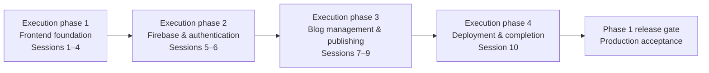

The four phases above are the **development-series groupings** from the master execution plan. The BRD separately describes three broader product-release phases; those two uses of “phase” should not be conflated.

**Planning note:** The master plan targets 20–25 minutes for each of ten recordings, which totals 200–250 minutes (3 hours 20 minutes–4 hours 10 minutes). Its stated overall estimate is approximately 4–4.2 hours. Keep the per-session target as the actionable estimate; reconcile the overall estimate when recording durations are known.

## Roadmap and milestone tracker

| Session | Execution phase | Planned milestone | Depends on | Status |
|---|---|---|---|---|
| 1 | Frontend foundation | Vite React application runs locally and is connected to GitHub | None | Not Started |
| 2 | Frontend foundation | Responsive shared layout, working routes, and Q&A Coming Soon placeholder | Session 1 | Not Started |
| 3 | Frontend foundation | Responsive Code Classic homepage matches the approved visual baseline | Session 2 and UI specification | Not Started |
| 4 | Frontend foundation | Visitors can browse blog listings and detail pages | Sessions 2–3 | Not Started |
| 5 | Firebase & authentication | Verified email/password and Google sign-in, password reset, and session handling work | Session 1; frontend routes from Session 2 | Not Started |
| 6 | Firebase & authentication | Profiles, trusted admin authorization, and Firestore rules are tested | Session 5 | Not Started |
| 7 | Blog management & publishing | Authorized admin can access dashboard/blog list and delete posts with confirmation | Session 6 | Not Started |
| 8 | Blog management & publishing | Admin can create, save, reopen, and edit drafts/posts | Session 7 | Not Started |
| 9 | Blog management & publishing | Admin publishing is integrated with public blog views | Sessions 4, 6, and 8 | Not Started |
| 10 | Deployment & completion | Application is deployed on Cloudflare Pages and passes production checks | Sessions 1–9 | Not Started |

**Status vocabulary**

- **Not Started:** No evidence that work on the milestone has begun.
- **In Progress:** Work has begun, but the acceptance gate has not passed.
- **Blocked:** A requirement, dependency, security, or data-integrity issue prevents safe completion.
- **Conditionally Accepted:** Critical checks pass; only documented non-critical follow-up remains.
- **Accepted:** All required acceptance criteria and evidence pass, the application is stable, and the Git checkpoint is complete.

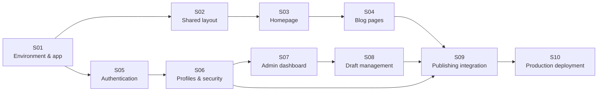

The dependency arrows show the planned handoffs, not completed work. Sessions should only be marked accepted after their own gates pass.

## Session-by-session visual report

### Session 1 — Development Environment and React Application

**Execution phase:** Frontend foundation · **Target recording:** 20–25 minutes  
**Status:** Not Started · **Depends on:** None

**Goal:** Verify the development tools, create the Vite React JavaScript application, understand its generated structure, run it locally, and establish the first GitHub checkpoint.

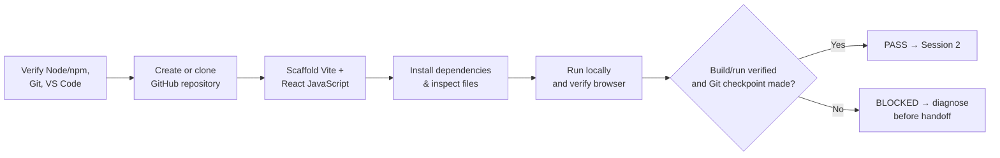

**Expected handoff:** A locally running Vite/React application, a verified repository connection, and a first commit.  
**Acceptance focus:** Tool versions/configuration are verified; the app starts in a browser; generated files are understood; the GitHub checkpoint succeeds without committing secrets. The shared navigation preserves Q&A as a Coming Soon placeholder only.

### Session 2 — Frontend Configuration and Common Layout

**Execution phase:** Frontend foundation · **Target recording:** 20–25 minutes  
**Status:** Not Started · **Depends on:** Session 1

**Goal:** Configure Bootstrap 5 and React Router, establish shared page layout, implement the header, navigation and footer, and verify responsive placeholder routes.

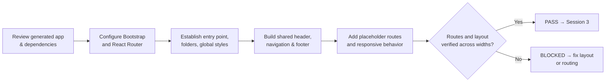

**Expected handoff:** A consistent responsive shell and working navigation between placeholder pages.  
**Acceptance focus:** Shared UI renders on target screen sizes; routes resolve; Q&A opens only a Coming Soon placeholder; no broken navigation or layout overflow remains.

### Session 3 — Code Classic Homepage

**Execution phase:** Frontend foundation · **Target recording:** 20–25 minutes  
**Status:** Not Started · **Depends on:** Session 2 and the approved UI specification

**Goal:** Build the homepage against the design document and reference image, including a three-column desktop composition, banner carousel, exactly five latest-blog previews, sidebars, and responsive rearrangement.

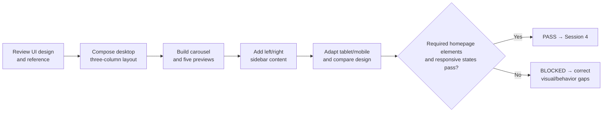

**Expected handoff:** A responsive homepage using temporary content where the backend is not yet available.  
**Acceptance focus:** Required homepage regions and exactly five previews are present; tablet/mobile layouts remain usable; visual comparison is recorded.

### Session 4 — Blog Listing and Detail Pages

**Execution phase:** Frontend foundation · **Target recording:** 20–25 minutes  
**Status:** Not Started · **Depends on:** Sessions 2–3

**Goal:** Add the blog listing and individual blog detail experience, including categories, ten previews per listing page, pagination, safe Markdown rendering, and YouTube embedding.

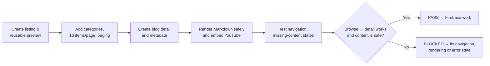

**Expected handoff:** Public-facing blog pages can use temporary content until Firebase integration.  
**Acceptance focus:** Listing/detail navigation works, pagination preserves category, invalid content is handled, and Markdown does not execute unsafe raw HTML.

### Session 5 — Firebase and Authentication

**Execution phase:** Firebase & authentication · **Target recording:** 20–25 minutes  
**Status:** Not Started · **Depends on:** Session 1; frontend routes from Session 2

**Goal:** Configure the Firebase web application and environment configuration; implement email/password and Google registration/sign-in, required email verification, password reset, logout, error handling, and auth-state persistence.

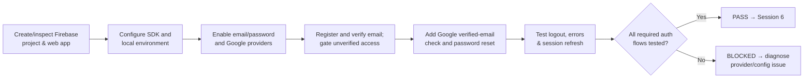

**Expected handoff:** Users can register, verify email, sign in/out, and reset passwords; configuration secrets are not committed.  
**Acceptance focus:** Verification email/pending and verified access behavior pass; unverified email/password users are gated; Google access requires a verified provider email; password-reset link works; auth state refreshes after verification.

### Session 6 — User Profiles, Admin Authorization and Firestore Security

**Execution phase:** Firebase & authentication · **Target recording:** 20–25 minutes  
**Status:** Not Started · **Depends on:** Session 5

**Goal:** Define profile/blog data shapes, configure Firestore, provision admin privilege through a trusted process, guard admin routes, and enforce verified-user and data permissions with Firestore Security Rules.

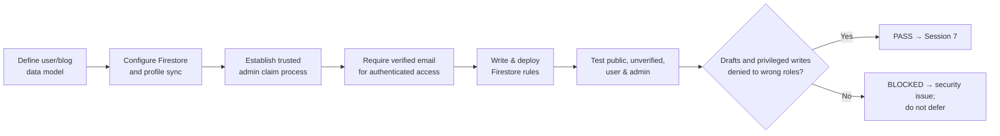

**Expected handoff:** Profile and post models, a trusted admin assignment process, and tested database authorization.  
**Acceptance focus:** Public users can read published posts only; unverified users cannot use authenticated features; drafts and admin writes/deletes are denied to public/ordinary users; users cannot self-assign admin. A UI route guard is not a substitute for database rules.

### Session 7 — Admin Dashboard and Blog Management Interface

**Execution phase:** Blog management & publishing · **Target recording:** 20–25 minutes  
**Status:** Not Started · **Depends on:** Session 6

**Goal:** Build a guarded admin dashboard and blog list with status/timestamp information, create/edit/view/delete actions, explicit delete confirmation, and loading, empty, and error states.

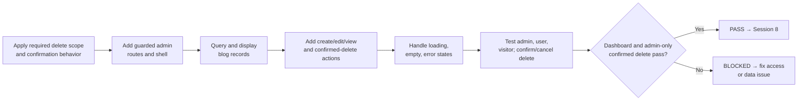

**Expected handoff:** Admin can see the management interface and perform confirmed post deletion; create/edit routes may still be placeholders.  
**Acceptance focus:** Admin-only access, accurate blog rows, visible UI states, no public draft access; confirm deletion removes the post, cancellation preserves it, and unauthorized deletion is denied.

### Session 8 — Blog Creation, Editing and Draft Management

**Execution phase:** Blog management & publishing · **Target recording:** 20–25 minutes  
**Status:** Not Started · **Depends on:** Session 7

**Goal:** Implement a validated admin form for title, description, Markdown content, category, tags, YouTube video ID, and optional thumbnail; save drafts and edit existing posts with correct timestamps.

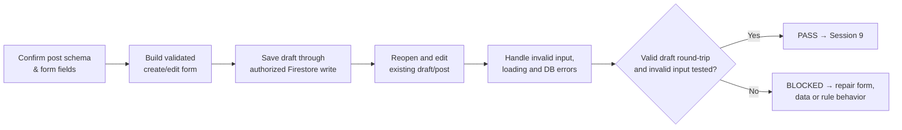

**Expected handoff:** An administrator can create, save, reopen, and edit drafts and existing posts.  
**Acceptance focus:** Required fields are validated; timestamps and status are correct; failures are visible; unauthorized writes remain denied.

### Session 9 — Blog Publishing and Public Content Integration

**Execution phase:** Blog management & publishing · **Target recording:** 20–25 minutes  
**Status:** Not Started · **Depends on:** Sessions 4, 6, and 8

**Goal:** Implement publish/unpublish operations and connect homepage, listing, and detail pages to Firestore while preserving published-only public access.

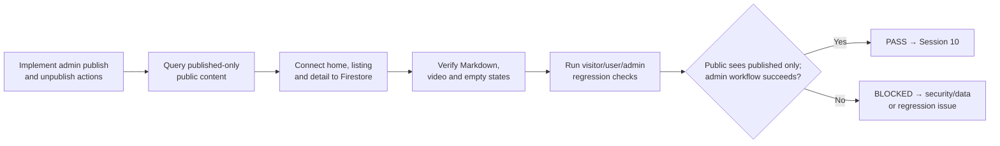

**Expected handoff:** Admin publication changes are reflected in public pages, and unpublishing removes public access.  
**Acceptance focus:** Public queries request published content; security rules independently prevent draft reads; admin publish/unpublish and all three role perspectives are verified.

### Session 10 — Cloudflare Deployment and Production Testing

**Execution phase:** Deployment & completion · **Target recording:** 20–25 minutes  
**Status:** Not Started · **Depends on:** Sessions 1–9

**Goal:** Build and deploy the application to Cloudflare Pages, configure production environment values and SPA routing as needed, and run production smoke, authentication, content, and security checks.

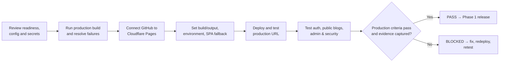

**Expected handoff:** A live Cloudflare Pages deployment with documented URL, production test evidence, and known limitations.  
**Acceptance focus:** Production build and deployment succeed; public pages/auth/admin flows are checked; Firestore rules are independently tested; no privileged credentials are exposed; browser/network failures are investigated.

## Cross-session acceptance and reporting rules

Each session requires an observable acceptance check, mandatory evidence, a stable state, and a Git checkpoint before it can be marked **Accepted**. A completed coding task alone is not a passing milestone.

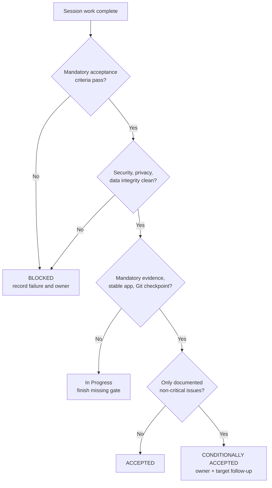

Never defer a security, privacy, or data-integrity issue as a conditional acceptance. Do not mark a check as passing without performing and recording it.

## Phase 1 scope guardrails

- **In scope:** public published blogs, email/password verification, Google sign-in for verified provider emails, password reset, profiles, trusted administrator blog management including confirmed deletion, drafts/publishing, responsive UI, YouTube embeds, Firestore access control, and Cloudflare Pages deployment.
- **Not functional Phase 1 features:** user-generated blogs, comments/replies, likes, functional Q&A, courses, documents, jobs, notifications, and advanced analytics.
- **Q&A placeholder:** show only “Coming Soon”; no sample/live-looking questions, question detail, answers, comments, search, or submission flows.
- **Architecture constraints:** no Spring Boot, microservices, API Gateway, unnecessary custom backend, or unapproved services.
- **Security constraints:** Firestore rules enforce data access; frontend route guards are supplemental; admin claims must come from a trusted process; never expose service-account credentials in client code.
- **Resolved baseline decisions:** delete is required for administrators with explicit confirmation; email verification and password reset are required authentication flows; Q&A is placeholder-only.

## Update log

| Date | Update |
|---|---|
| 2026-11-14 | Created the initial visual roadmap from the 10-session master execution plan. All sessions are recorded as Not Started because no application implementation was verified. |
| 2026-11-14 | Recorded the difference between the summed per-session duration and the master plan's approximate overall recording estimate. |
| 2026-11-14 | Aligned Phase 1 report with the baseline BRD/TDD/UI decisions: verified-email access, password reset, confirmed admin deletion, Q&A Coming Soon only, and the master plan's Phase 1-only execution scope. |
